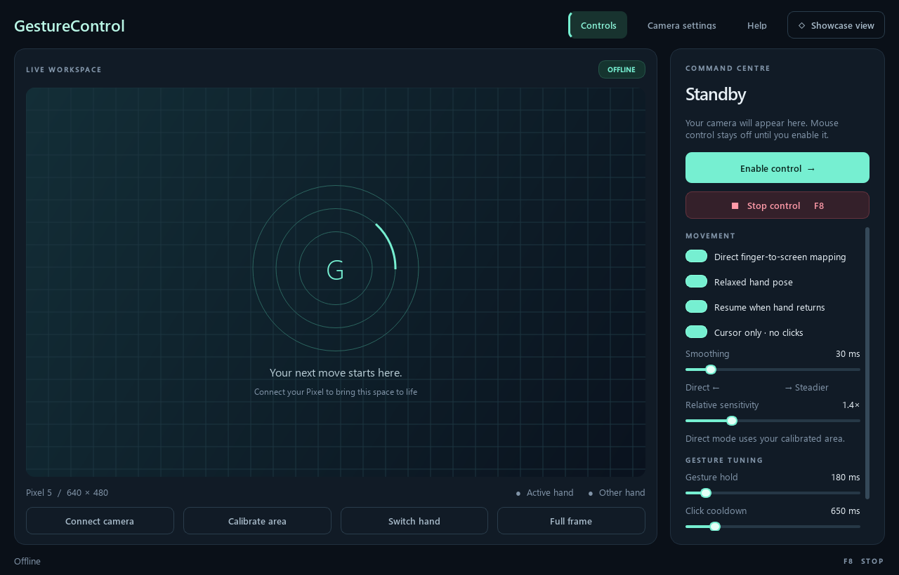

# GestureControl Studio

**Turn your hand into a Windows mouse—with your phone as the camera.**

A local Python desktop app combining phone video, hand tracking and a native control dashboard. Developed with a Google Pixel 5 and DroidCam; other OpenCV-compatible cameras can also be configured.



## Features

- Native dark dashboard with embedded video, landmarks and a compact status bar.
- Relaxed-hand cursor mode: track your index fingertip without folding the other fingers.
- Absolute finger-to-screen mapping or relative movement, with adjustable smoothing.
- Persistent controlling-hand selection; your other hand can remain visible.
- Automatic tracking resume, with a latched **F8 emergency stop**.
- Optional pinch click, two-finger scroll, fist drag and open-palm pause.
- Full-frame tracking or a custom calibrated region.
- **Showcase view:** live hand skeletons on a clean grid instead of the camera background.
- Wi-Fi DroidCam streams and numbered Windows cameras, including DroidCam USB.
- Local inference: no camera uploads, recording service or cloud account required by GestureControl.

This is an experimental input project. Start in cursor-only mode and tune it for your camera angle and lighting.

## Quick start

**Requirements:** Windows 10/11, Python 3.12 with the `py` launcher, and a webcam or phone running DroidCam.

```powershell
git clone https://github.com/vector81/gesturecontrol.git
cd gesturecontrol
.\Setup.bat
.\Launch.bat
```

Setup creates `.venv`, installs pinned dependencies, downloads and verifies the hand model, creates `config.json` from the example, and runs a hardware-free self-test. Setup needs internet access; inference is local afterward. Model binaries and dependencies are not bundled in Git.

1. In **Camera settings**, enter a camera index or local stream URL, then **Save & reconnect**.
2. Check the preview, orientation and highlighted controlling hand.
3. Keep **Cursor only** enabled while tuning. Click **Enable control** when ready.
4. Use **Stop control** or **F8** to stop. F8 stays stopped until explicitly re-enabled.

Studio always starts in preview-only mode. Once enabled, automatic resume lets your hand leave and return without repeatedly pressing a key.

## Connect DroidCam

Install the phone app and, for a Windows virtual camera, the matching client from [DroidCam's official site](https://droidcam.app/). Classic and current DroidCam use different clients.

### Direct Wi-Fi

Keep the phone and PC on the same trusted local network. Open DroidCam, allow camera access, and use the IP and port it displays:

```text
http://PHONE_IP:4747/video/force/640x480
```

Replace `PHONE_IP` with the phone's actual local IPv4 address. This 640×480 stream was verified without DroidCam's HD watermark. If your app version does not support that path, try `/video` or the Windows client. Only literal local/private IP URLs are accepted; public internet sources and hostnames are rejected.

### Windows virtual camera / USB

Connect the phone in the DroidCam Windows client and confirm video there first. Enter its camera index in Studio. **Scan USB cameras** checks indices 0–5 while disconnected; higher indices can be entered manually. Try DSHOW, MSMF or AUTO if a device does not open. Indices may differ between backends.

For USB, follow [DroidCam's instructions](https://droidcam.app/help/). Android versions using ADB require USB debugging and authorization on the phone. Windows may need the [official Google USB driver](https://developer.android.com/studio/run/win-usb) for a Pixel. GestureControl does not automatically install phone apps or drivers.

## Make it comfortable

Mount the phone securely above the monitor, aimed at your hand workspace, with zoom at 1×. Use even lighting and keep the entire controlling hand visible. Rotation and mirroring are configurable.

- **Full frame** uses all camera width and height.
- **Calibrate area** pauses control and lets you click opposite corners of a comfortable region. Click it again to cancel.
- **Direct mapping** maps the region to the primary screen. The same fingertip position returns to the same cursor position, with a small edge margin. It maps to the whole screen, not the preview window.
- **Smoothing** trades responsiveness for steadiness. Zero follows the detected position directly.
- **Relative sensitivity** applies only when direct mapping is off.
- **Switch hand** changes selection. Green/yellow marks the controlling hand; grey marks the ignored hand. If the selected hand leaves, the app waits for it rather than transferring control.

MediaPipe estimates hand identity; overlapping or partly hidden hands may cause uncertainty and pause output. The current version controls the **primary monitor only**.

## Modes and gestures

In **relaxed cursor-only mode**, your index fingertip controls position with the other fingers open or folded. Open palm does not pause in this mode; use Stop or F8. Clicks, dragging and scrolling are disabled.

Turn off **Cursor only** for full gestures. This pauses the session first; enable control deliberately afterward.

| Action | Full-gesture pose |
|---|---|
| Move | Index extended, other three fingers folded, thumb clear of index |
| Click | Hold pointing first, then pinch thumb and index; return to pointing before another click |
| Scroll | Index and middle extended, ring and little fingers folded; move vertically |
| Drag | Hold a closed fist for at least 0.35 seconds, then move; leaving fist releases |
| Pause | Open palm with all four fingers extended |

The panel exposes gesture dwell, click cooldown and scroll sensitivity. Fist and pinch can be ambiguous at some angles; check the preview before enabling actions. Automatic resume restores control after a stable pointing pose returns. Manual stop and F8 remain latched.

| Control | Behavior |
|---|---|
| F8 | Global emergency stop; releases dragging and stays stopped |
| F9 | Global enable/pause, with a short window to reposition your hand |
| Stop control | Immediate dashboard stop |
| Showcase view | Hand skeletons instead of the camera background |
| Close Studio | Stop input and shut down capture |

## How it works

OpenCV captures recent frames in a separate process. MediaPipe inference runs off the UI thread. A gesture state machine drives PyAutoGUI; an independent watchdog stops control if tracking stalls. The PySide6 dashboard communicates through in-memory queues.

```text
Phone / webcam → OpenCV → MediaPipe → hand selection → controller → Windows mouse
                            ↓                            ↑
                      Studio preview ← memory bridge → controls
```

Capture timeouts, stale-frame rejection, button release, dwell, pinch hysteresis and cooldowns reduce unintended actions. They cannot guarantee behavior during an OS freeze or on the Windows secure desktop. Video already buffered or repeated inside camera software may not be detectable from pixels alone.

## Privacy and local files

Runtime processing occurs on your PC. Wi-Fi video travels from the phone over your LAN. DroidCam is a separate app with its own terms and settings.

`config.json` contains your connection and preferences; `live_status.json` contains local diagnostics. Both are ignored by Git, along with logs, screenshots, drivers, models and virtual environments. Normal operation does not save camera images. The optional UI acceptance script saves a skeleton-only dashboard screenshot locally.

## Testing and development

```powershell
.venv\Scripts\python.exe -m pytest -q
.venv\Scripts\python.exe selftest.py
```

Tests use fake mouse sinks, synthetic landmarks and a generated loopback MJPEG stream. Some briefly open blank previews; they do not inject physical pointer actions.

After configuring a camera, this optional check exercises real video and Studio controls with mouse output intercepted:

```powershell
.venv\Scripts\python.exe tools\check_studio.py
```

See [validation coverage](TEST_REPORT.md) and [contribution instructions](CONTRIBUTING.md).

The original diagnostic preview remains available:

```powershell
.venv\Scripts\python.exe app.py --dry-run
.venv\Scripts\python.exe app.py --video-test
.venv\Scripts\python.exe app.py --probe 0
```

`--dry-run` tracks without physical mouse input. In the OpenCV preview: Q/Esc exits, Space enables/pauses, H switches hand, C calibrates, M toggles cursor-only. Studio uses its buttons instead.

## Troubleshooting

- **No video:** confirm DroidCam is running, verify the IP/port or index, close competing consumers and try another backend for numbered cameras.
- **Too zoomed:** reset DroidCam zoom to 1×.
- **No movement:** enable control, verify the selected hand and keep its fingertip inside the region. Use Switch hand if needed.
- **Jitter or lag:** improve lighting, adjust smoothing, lower resolution or use USB. Check actual tracking FPS in the status bar.
- **Gesture problems:** test in an empty document; check pose, dwell and cooldown. Return to cursor-only mode while tuning.
- **Startup failure:** inspect `last_error.log` or `studio-error.log`. Redact personal details before sharing logs.

## License

Original project code is [MIT licensed](LICENSE). Dependencies, model assets, DroidCam and Windows fonts retain their upstream terms; see [third-party notices](THIRD_PARTY_NOTICES.md).

Not affiliated with Google, MediaPipe or DroidCam.
